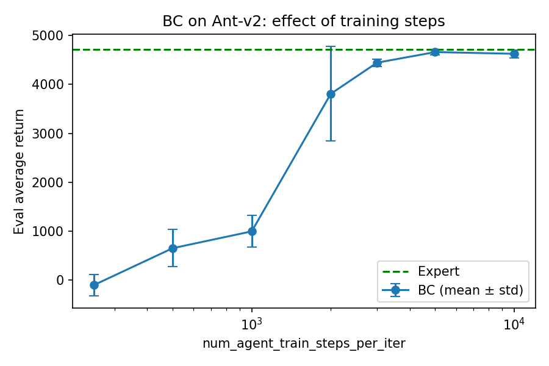
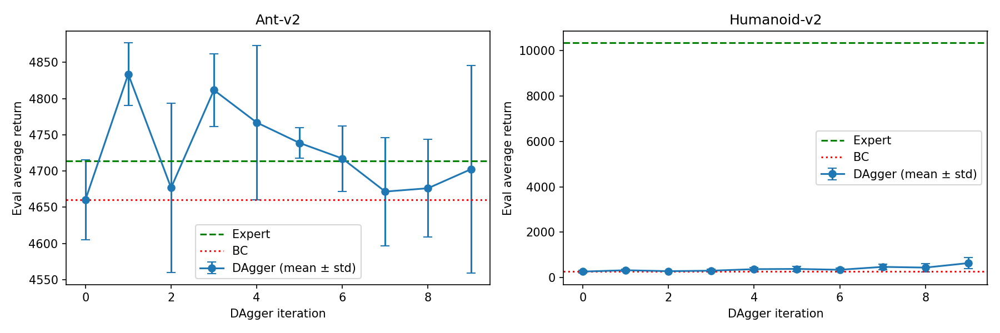

# HW1 Learning Report — Imitation Learning (BC + DAgger)

## TL;DR
- **Behavior Cloning (BC)** = supervised learning on expert `(observation → action)` pairs.
- It works when the student rarely leaves the expert's states (**Ant: 98.9% of expert**) and fails when small errors snowball (**Humanoid: 2.6%**).
- **DAgger** fixes the snowballing by letting the student drive and asking the expert to label the states the student actually visits (**Humanoid: 270 → 643 in 9 rounds**).
- Biggest insight: **training loss ≠ performance**. Return measures *survival over 1000 steps*, so tiny per-step improvements produce huge jumps in return.

---

## 1. Core concepts

### 1.1 Vocabulary
| Term | Plain English | Symbol | Code |
|---|---|---|---|
| Observation / state | what the robot senses (Ant: 111 numbers) | $s$ | `obs`, `ob_no` |
| Action | motor commands (Ant: 8 numbers in [−1, 1]) | $a$ | `ac`, `ac_na` |
| Policy | the "brain": observation → action | $\pi_\theta(a \mid s)$ | `MLPPolicySL` |
| Reward | score the simulator gives each step | $r_t$ | `re_n` |
| Attempt = episode = trajectory = rollout = path | one run from `reset()` until fall or 1000 steps | $\tau$ | a `path` dict |
| Return | total reward of one attempt | $R = \sum_t r_t$ | `Eval_AverageReturn` |
| `ep_len` | max steps per attempt (cap, not target) | $T$ | 1000 |

Shape suffixes: `_no` = (batch, obs dim), `_na` = (batch, action dim), `_n` = (batch,).

### 1.2 Behavior Cloning objective
Plain English: make the expert's action as likely as possible under the student's policy.
$$
\theta^* = \arg\max_\theta \; \mathbb{E}_{(s,a^*)\sim\mathcal{D}}\big[\log \pi_\theta(a^*\mid s)\big]
$$

### 1.3 Gaussian policy → MSE
Plain English: the policy outputs a bell curve — center $\mu_\theta(s)$ from the network (`mean_net`), width $\sigma$ from a separate learnable vector (`logstd`, **not** an output of the network, same for every state).

Negative log-likelihood of one action:
$$
-\log \pi_\theta(a^*\mid s) = \frac{(a^* - \mu_\theta(s))^2}{2\sigma^2} + \log\sigma + \text{const}
$$
With $\sigma$ fixed, minimizing this = minimizing $(a^* - \mu)^2$ → **MSE**.

### 1.4 Why store `logstd` instead of `std`
- A width must be > 0; the optimizer doesn't know that and could push it negative.
- So let the optimizer move `logstd` freely, and compute $\sigma = e^{\text{logstd}} > 0$ always.

### 1.5 `sample()` vs `rsample()` vs `mean`
| | Formula | Gradient reaches `logstd`? | Used for |
|---|---|---|---|
| `dist.mean` | $\mu$ | ❌ | training (simple) / acting deterministically |
| `dist.rsample()` | $\mu + \sigma\epsilon$ | ✅ | training (what we used) |
| `dist.sample()` | same, but detached | ❌ blocks all gradients | acting (`get_action`) |

With `rsample` + MSE, expected loss $= (a^* - \mu)^2 + \sigma^2$ → training pushes $\sigma \to 0$ (observed: 1.0 → 0.83 in 200 steps).

### 1.6 Compounding error (why BC fails)
- Training states come from the **expert**; test states come from the **student** → *distribution shift*.
- A small mistake → unfamiliar state → bigger mistake → … → fall.
$$
\text{BC: } O(\epsilon T^2) \qquad \text{DAgger: } O(\epsilon T)
$$

### 1.7 Why return jumps while loss changes a little
Plain English: return ≈ (steps survived) × (~4.7 reward/step). Each step has a small chance $p$ of an unrecoverable mistake:
$$
P(\text{survive } 1000 \text{ steps}) = (1-p)^{1000}
$$
| $p$ | 0.005 | 0.002 | 0.001 | 0.0005 |
|---|---|---|---|---|
| finish rate | 0.7% | 14% | 37% | 61% |

→ tiny loss gains flip "falls" into "survives" → return jumps 4×.

### 1.8 DAgger
Plain English: *let the student drive, have the expert correct it.* Keep the student's **observations**, replace its **actions** with the expert's, add to the dataset, retrain on everything.

---

## 2. The training pipeline

### 2.1 BC (one iteration)
```
SETUP   build_mlp (111→64→64→8), empty replay buffer, load expert
LOAD    collect_training_trajectories(itr=0) → pickle.load → 2 paths × 1000 = 2000 pairs → buffer
STUDY   train_agent: 5000 × [ sample_random_data(100) → update(): rsample → MSE → zero_grad/backward/step ]
TEST    sample_trajectories(≥5000 env steps) → several attempts → mean ± std of returns
```

### 2.2 DAgger (10 iterations)
```
Round 0:   exactly BC
Round 1–9: ① student walks ≥1000 steps         (sample_trajectories with collect_policy = student)
           ② expert relabels actions            (do_relabel_with_expert)
           ③ append to buffer (2000 → ~11000)   (add_to_replay_buffer)
           ④ train 5000 steps on WHOLE buffer   (train_agent)
           ⑤ test                              (perform_logging)
```

### 2.3 Two meanings of "sample" (big source of confusion)
| Function | What it does | Simulator? | Purpose |
|---|---|---|---|
| `sample_random_data` | draw flashcards from the notebook | ❌ | studying |
| `sample_trajectory(ies)` | robot walks | ✅ | testing / DAgger collection |

### 2.4 Two meanings of "step" and "batch"
| Name | Means | Value |
|---|---|---|
| env step | one simulator tick | — |
| training step | one weight update | `num_agent_train_steps_per_iter` |
| `train_batch_size` | flashcards per training step | 100 |
| `batch_size` | env steps the student collects per DAgger round | 1000 |
| `eval_batch_size` | env steps used for testing | 5000 |

---

## 3. What I implemented
| File | Function | Idea |
|---|---|---|
| `pytorch_util.py` | `build_mlp` | Linear+tanh × `n_layers`, final Linear+identity (motors need negatives) |
| `MLP_policy.py` | `forward` | return `Normal(mean_net(obs), exp(logstd))` |
| `MLP_policy.py` | `get_action` | numpy → tensor (batch dim via `obs[None]`) → `.sample()` → numpy |
| `MLP_policy.py` | `MLPPolicySL.update` | `rsample` → MSE → zero_grad / backward / step |
| `replay_buffer.py` | `sample_random_data` | one shared `np.random.permutation` index for all 5 arrays |
| `utils.py` | `sample_trajectory` | reset → loop(get_action → step → record) until `done or steps >= max` |
| `utils.py` | `sample_trajectories` / `sample_n_trajectories` | until ≥ N steps / exactly N attempts |
| `rl_trainer.py` | `collect_training_trajectories` | itr 0: load pkl; else student walks |
| `rl_trainer.py` | `train_agent` | `agent.sample` → `agent.train` loop |
| `rl_trainer.py` | `do_relabel_with_expert` | `path['action'] = expert.get_action(path['observation'])` |

---

## 4. Results

### Table 1 — Expert returns (2 trajectories)
| | Ant | Humanoid | Walker2d | Hopper | HalfCheetah |
|---|---|---|---|---|---|
| Mean | 4713.65 | 10344.52 | 5566.85 | 3772.67 | 4205.78 |
| Std | 12.20 | 20.98 | 9.24 | 1.95 | 83.04 |

### Table 2 — BC (2×64 MLP, 2000 pairs, 5000 steps, batch 100)
| | Expert | BC | % of expert |
|---|---|---|---|
| Ant-v2 | 4713.65 ± 12.20 | 4660.27 ± 55.31 | **98.9%** |
| Humanoid-v2 | 10344.52 ± 20.98 | 269.92 ± 60.74 | **2.6%** |

Humanoid attempts lasted ~50 steps → textbook compounding error.

### Figure 1 — BC training-steps sweep (Ant)


| Steps | 250 | 500 | 1000 | 2000 | 3000 | 5000 | 10000 |
|---|---|---|---|---|---|---|---|
| Return | −100 | 655 | 999 | 3808 ± 964 | 4443 | 4660 | 4625 |
| Loss | 0.194 | 0.093 | 0.039 | 0.013 | — | — | — |

- ≤1000: under-trained, falls. 2000: threshold (huge std — some attempts survive, some fall). ≥5000: **plateau** (no overfitting — small net can't memorize).

### Figure 2 — DAgger


| Iter | 0 | 1 | 2 | 3 | 4 | 5 | 6 | 7 | 8 | 9 |
|---|---|---|---|---|---|---|---|---|---|---|
| Ant | 4660 | 4834 | 4677 | 4812 | 4767 | 4739 | 4717 | 4672 | 4676 | 4702 |
| Humanoid | 270 | 330 | 288 | 309 | 377 | 387 | 350 | 477 | 446 | 643 |

- Ant: BC already ≈ expert → DAgger has nothing to fix.
- Humanoid: steady climb (2.4×), still far from expert → needs more rounds / bigger net.

### Videos (`videos/`, made with `make_videos.py`)
| Clip | Steps | Return | What to watch for |
|---|---|---|---|
| `Ant-v2_expert.mp4` | 1000 | 4699 | smooth gait |
| `Ant-v2_bc.mp4` | 1000 | 4601 | nearly identical to expert |
| `Humanoid-v2_expert.mp4` | 1000 | 10538 | running |
| `Humanoid-v2_bc.mp4` | **49** | 263 | starts like the expert, drifts, falls — compounding error |

---

## 5. Debugging lessons (Python / PyTorch)
| Mistake made | Lesson |
|---|---|
| `[a, b for i in ...]` | a comprehension yields **one** item per iteration → use a `for` loop + `.extend`/`+=` |
| Linear layers with no activation between | stacked Linears collapse into **one** Linear |
| Code written in parent `update` | child method **overrides** parent; Python looks in the object's own class first |
| `get_action` inside `update` | `.sample()` + numpy round-trip **breaks the gradient graph** → stay in torch |
| Forgot `zero_grad` concept | PyTorch **accumulates** gradients (`+=`) by design |
| `sample_n_trajectories` vs `sample_trajectories` vs `sample_trajectory` | read the HINTs — names are spelled out; one letter matters |
| `self.params['ep_length']` | wrong dict key → `KeyError`; copy keys from code |
| `timesteps += 1` | counts attempts, not steps → use `get_pathlength` |
| `steps == max` | prefer `>=` (can't be skipped past) |
| `ac = ac[0]` | `get_action` returns batch of 1 → unwrap |

## 6. Environment lessons
- `-v2` MuJoCo envs need `mujoco_py` → system GL headers (`libosmesa6-dev`, …).
- `mujoco==2.2.1` no longer on PyPI → `2.2.2`.
- `torch 1.12.1` has no kernels for this GPU → `--no_gpu` (tiny MLP, CPU is fine).
- Redirected stdout is buffered → read progress from TensorBoard event files.

---

## 7. Self-assessment

### Solid ✅
- BC as supervised learning; dataset structure; replay buffer pairing
- Gaussian policy, `logstd` trick, `rsample` vs `sample`, why σ → 0
- Batch dimension, training loop, gradient flow
- Compounding error / distribution shift; DAgger's fix
- Reading experiment results (threshold, plateau)

### Revisit 🔁
- Python fundamentals: comprehensions, inheritance/overriding, exact API names
- PyTorch's 3-line update — say it from memory
- Derive the Gaussian NLL → MSE yourself on paper
- Why DAgger gives $O(\epsilon T)$ (Ross et al. 2011, Thm 3.1)

### Self-check questions
1. Why does BC see each expert pair ~250 times at 5000 steps, and is that a problem?
2. In DAgger, why keep the student's observations but discard its actions?
3. Why sample training batches from the **whole** buffer rather than only the newest round?
4. Why does Humanoid fail far worse than Ant under BC?
5. If you evaluated with `dist.mean` instead of `.sample()`, would Ant at 1000 steps score higher? Why?

## 8. Open experiments
- ✅ **Done — eval with `mean` vs `sample()` (Ant, 1000 training steps, σ = 0.18, 5 episodes each):**
  `sample` 1277 ± 678 vs `mean` **2914 ± 1219** (2.3×), both 1000 steps long (no falls). Noise didn't cause falls here — it wasted reward per step (control cost ∝ ‖a‖², jittery, less forward progress).
- Humanoid DAgger for 30+ rounds, or `--size 256 --n_layers 3`.
- BC with 1 vs 2 expert trajectories (data quantity sweep).
