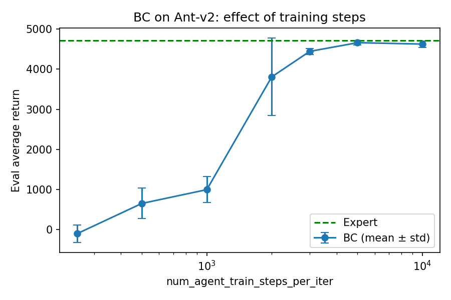
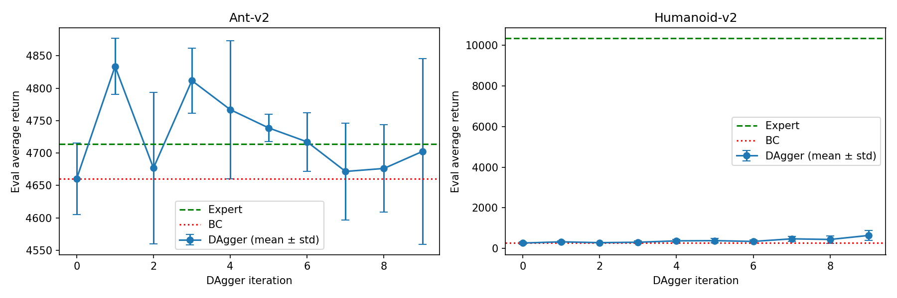

# Imitation Learning: Behavior Cloning & DAgger on MuJoCo

Behavior Cloning (BC) and DAgger implemented in PyTorch, then evaluated on MuJoCo locomotion tasks (Ant, Humanoid). The goal is to show where plain supervised imitation works, where it breaks down because errors compound, and how DAgger recovers.

> Coursework for **CMU 16-831 Introduction to Robot Learning** (Homework 1). The course staff provided the starter framework (logging, expert policies, and expert data in [`cmuroboticsdrl/16831-S26-HW`](https://github.com/cmuroboticsdrl/16831-S26-HW)). I implemented the learning components listed under [What I implemented](#what-i-implemented), plus the experiments, plotting, and video tooling.

## Highlights

| Task | Expert | BC | DAgger (iter 9) |
|---|---|---|---|
| Ant-v2 | 4714 ± 12 | 4660 ± 55 (**98.9%**) | 4702 |
| Humanoid-v2 | 10345 ± 21 | 270 ± 61 (**2.6%**) | 643 (**2.4× BC**) |

- **BC works when the student rarely leaves the expert's state distribution.** On Ant it nearly matches the expert from only 2,000 demonstration pairs.
- **BC fails when small errors compound.** The Humanoid BC policy falls after about 50 steps; learned from expert-visited states alone, the error grows as O(εT²).
- **DAgger fixes the distribution shift.** The student drives, the expert relabels the states the student actually visits, and the error bound drops to O(εT). Humanoid return improves steadily over 9 rounds.
- **Low training loss doesn't mean high return.** Return measures survival over 1000 steps, so small per-step improvements can produce large jumps in return (see the training-steps sweep).

| BC training-steps sweep (Ant) | DAgger vs. BC vs. expert |
|---|---|
|  |  |

Rollout videos for the expert and the BC student are in [`videos/`](videos/). Compare `Humanoid-v2_bc.mp4` with `Humanoid-v2_expert.mp4` to see compounding error in action.

## How it works

- **Policy:** a 2×64 tanh MLP outputs the mean of a Gaussian. The standard deviation is a separate state-independent parameter, learned in log space (`logstd`).
- **BC objective:** maximize the log-likelihood of expert actions. I train with the MSE between reparameterized samples (`rsample()`) and expert actions.
- **DAgger loop:** train on expert data → roll out the student → relabel the visited states with the expert's actions → aggregate the data in the replay buffer → retrain.

## What I implemented

| File | Component |
|---|---|
| [`rob831/infrastructure/pytorch_util.py`](rob831/infrastructure/pytorch_util.py) | `build_mlp`: configurable MLP builder |
| [`rob831/policies/MLP_policy.py`](rob831/policies/MLP_policy.py) | Gaussian/categorical policy `forward`, `get_action`, supervised `update` |
| [`rob831/infrastructure/replay_buffer.py`](rob831/infrastructure/replay_buffer.py) | Aligned random minibatch sampling |
| [`rob831/infrastructure/utils.py`](rob831/infrastructure/utils.py) | Rollout collection (`sample_trajectory`, `sample_trajectories`, `sample_n_trajectories`) |
| [`rob831/infrastructure/rl_trainer.py`](rob831/infrastructure/rl_trainer.py) | Data collection, training loop, DAgger expert relabeling |
| [`plot_results.py`](plot_results.py), [`make_videos.py`](make_videos.py) | Figure generation from TensorBoard logs; expert/student rollout videos |

## Repository layout

```
rob831/            # library code (agents, policies, infrastructure, run script)
data/              # TensorBoard logs for the reported runs (+ saved BC policies)
figures/           # generated plots
videos/            # expert vs. BC rollouts
report/            # LaTeX write-up and PDF
LEARNING_REPORT.md # detailed notes: derivations, pipeline walkthrough, debugging lessons
RUN.md             # exact commands to reproduce every result
```

## Quickstart

```bash
conda create -n rob831 python=3.10 && conda activate rob831
pip install -r requirements.txt && pip install -e .
# MuJoCo setup details: installation.md

# Behavior cloning on Ant
python rob831/scripts/run_hw1.py --expert_policy_file rob831/policies/experts/Ant.pkl \
  --env_name Ant-v2 --exp_name bc_ant --n_iter 1 \
  --expert_data rob831/expert_data/expert_data_Ant-v2.pkl \
  --num_agent_train_steps_per_iter 5000 --eval_batch_size 5000 --video_log_freq -1

# DAgger on Humanoid
python rob831/scripts/run_hw1.py --expert_policy_file rob831/policies/experts/Humanoid.pkl \
  --env_name Humanoid-v2 --exp_name dagger_humanoid --n_iter 10 --do_dagger \
  --expert_data rob831/expert_data/expert_data_Humanoid-v2.pkl \
  --num_agent_train_steps_per_iter 5000 --batch_size 1000 --eval_batch_size 5000 --video_log_freq -1

python plot_results.py   # regenerate figures/
tensorboard --logdir data
```

See [RUN.md](RUN.md) for every command used to produce the results above, and [LEARNING_REPORT.md](LEARNING_REPORT.md) for the full analysis.

## Acknowledgements

Starter code, expert policies, and expert data come from CMU 16-831 (Spring 2026).
